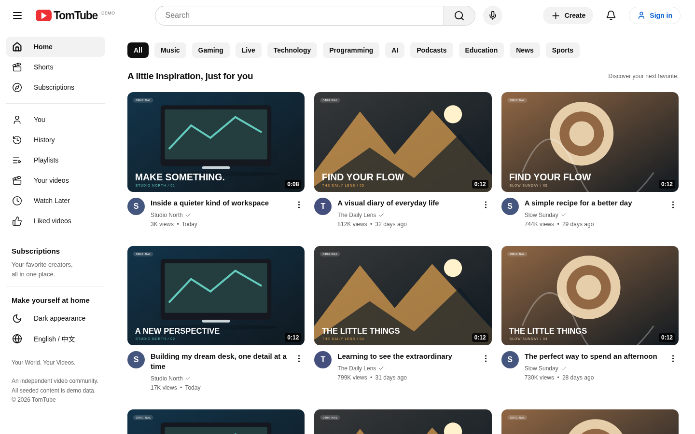
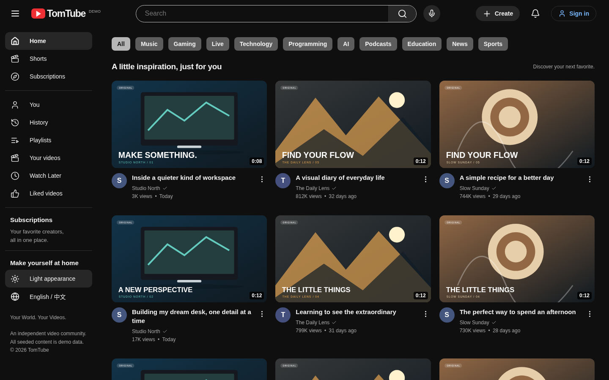
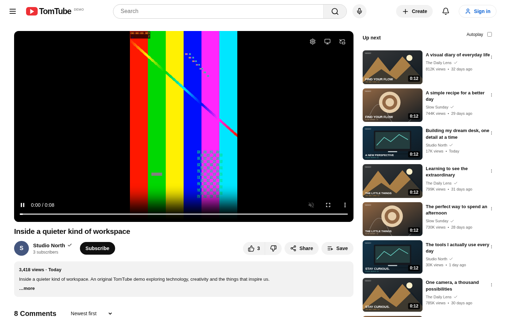
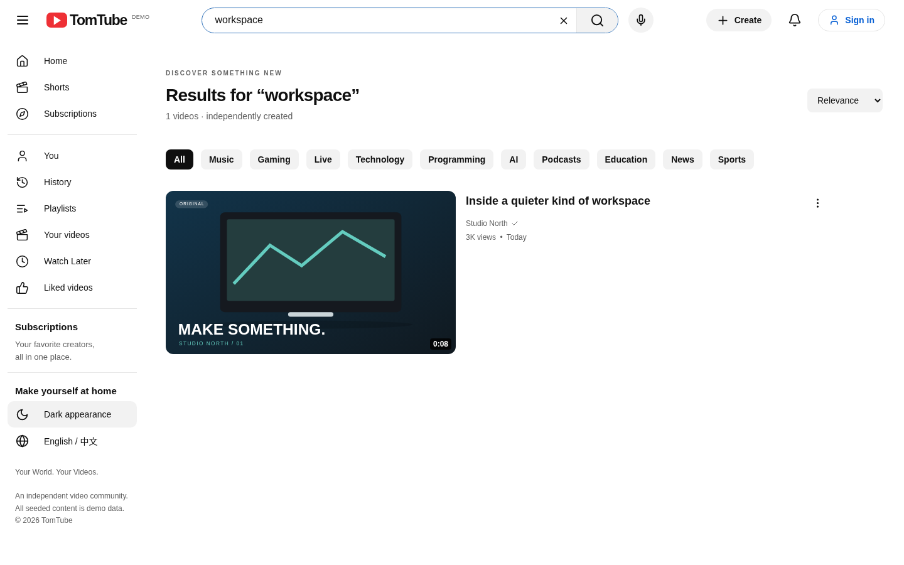
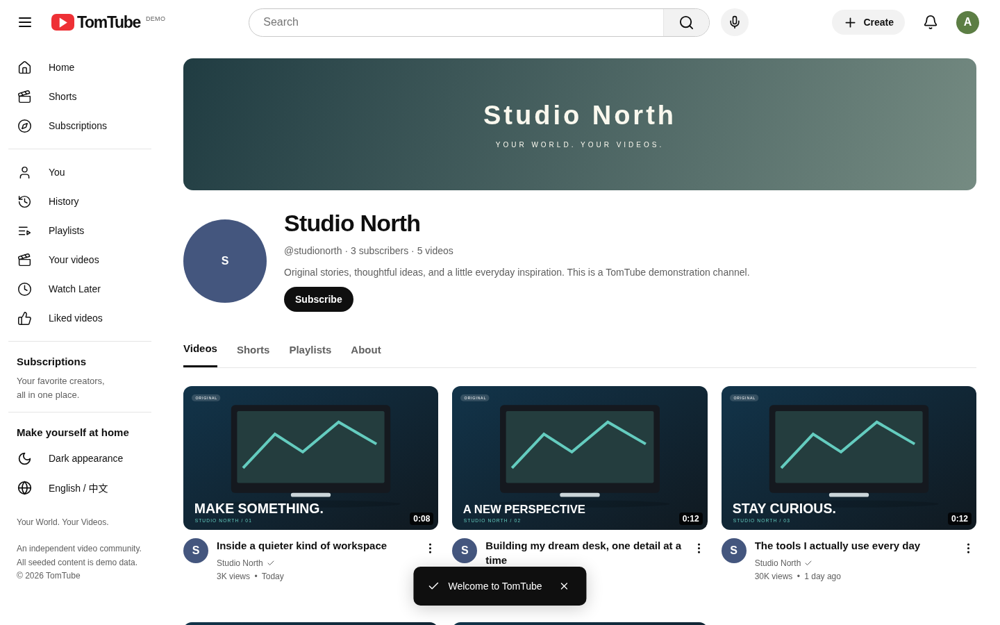
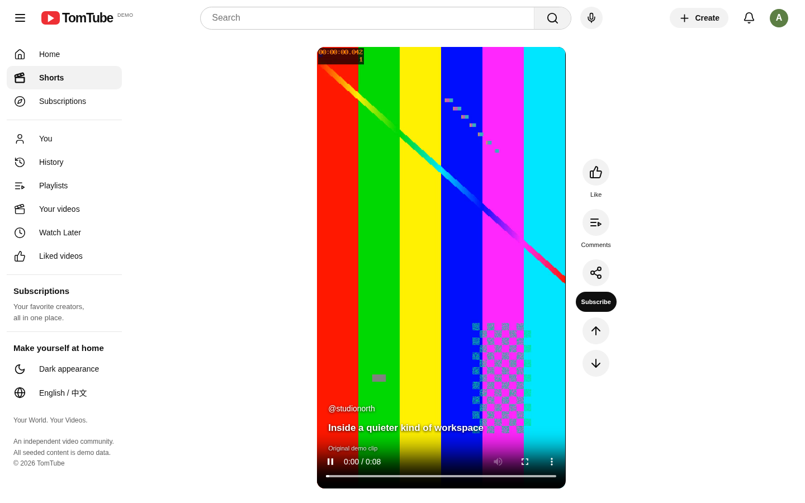
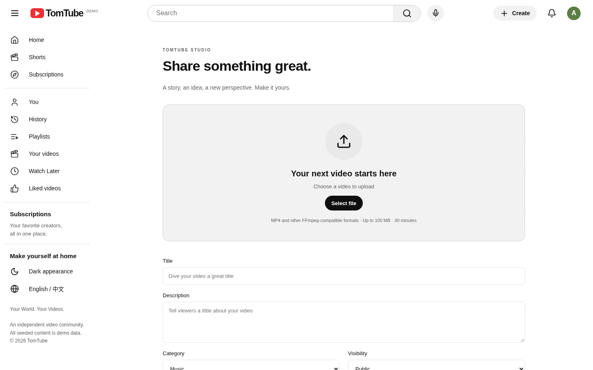
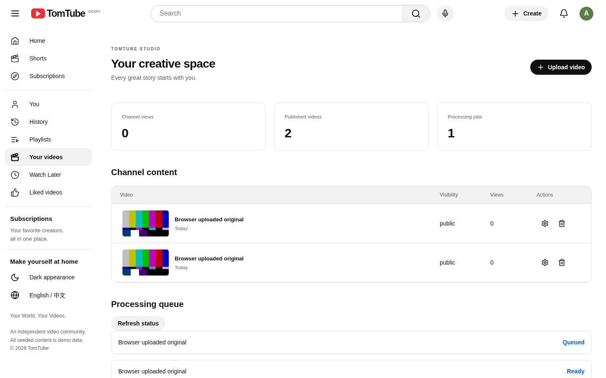
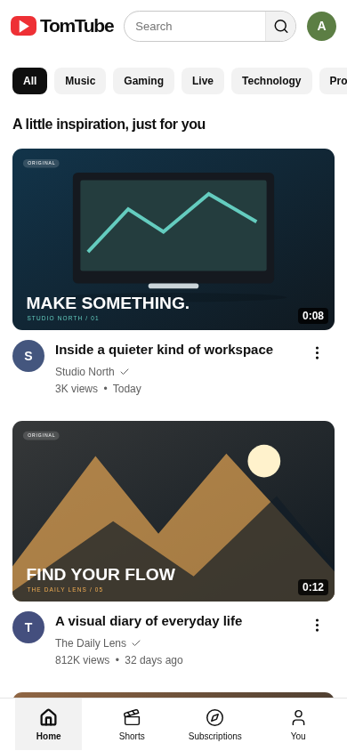
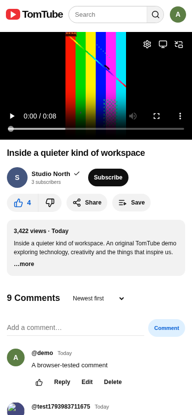

# TomTube

**Your World. Your Videos.**

一个真实运行的视频分享 Web 应用，采用独立 TomTube 品牌，提供熟悉的视频平台布局与实际持久化交互。项目在云环境中开发，截图与验收视频均来自运行中的网站。

> 本项目与 YouTube / Google 无隶属关系。演示频道、观看次数及初始化评论均为 Demo 数据；媒体与缩略图由本地生成。当前为可运行的本地开发版本，尚未实现原需求的全部功能。



## 验收视频

**点击预览或下方链接，观看 / 下载真实浏览器录屏。** 视频为无声录屏，播放操作已静音；并非根据截图拼接的概念演示。

[](https://raw.githubusercontent.com/Tomhao10225101490/Tomitomi/main/TomTube/docs/acceptance/desktop-acceptance.mp4)

| 视频 | 展示范围 |
| --- | --- |
| [桌面端完整验收 · MP4](https://raw.githubusercontent.com/Tomhao10225101490/Tomitomi/main/TomTube/docs/acceptance/desktop-acceptance.mp4) | 首页、明暗主题、搜索、真实播放、登录、点赞、订阅、评论、频道、Shorts、上传、FFmpeg 处理、新视频播放、历史记录、播放列表 |
| [移动端验收 · MP4](https://raw.githubusercontent.com/Tomhao10225101490/Tomitomi/main/TomTube/docs/acceptance/mobile-acceptance.mp4) | 390 × 844 首页、滚动浏览与实际视频播放 |

[录制说明与时间线](TomTube/docs/acceptance/README.md) · [机器可读录制结果](TomTube/docs/acceptance/recording-results.json) · [可复现录制脚本](TomTube/scripts/record-acceptance.mjs)

GitHub README 不保证内嵌播放仓库内的 MP4，所以上方提供实际录屏的 GIF 预览及原始 MP4 入口。若浏览器直接下载文件，可下载后使用系统播放器观看。

## 页面截图

以下均为真实 Chromium 截图。点击图片可查看原图。

| 首页 · 浅色 | 首页 · 深色 |
| --- | --- |
|  |  |

| 视频播放页 | 搜索结果 |
| --- | --- |
|  |  |

| 频道主页 | Shorts |
| --- | --- |
|  |  |

| 视频上传 | Creator Studio |
| --- | --- |
|  |  |

| 移动端首页 · 390 × 844 | 移动端播放页 · 390 × 844 |
| --- | --- |
|  |  |

另附 [1920px 首页](TomTube/screenshots/extra-home-1920.png) 与 [1280px 首页](TomTube/screenshots/extra-home-1280.png)。

## 已实现

- 固定导航、可折叠侧栏、分类筛选、搜索建议及本地搜索历史。
- 注册、登录、退出、服务端 Session、资料编辑、头像与横幅上传。
- 数据库搜索、频道主页、基础推荐排序、明暗主题与响应式页面。
- 原生视频播放、倍速、循环、进度保存、快捷键、影院模式及浏览器支持的画中画。
- 持久化评论与回复、评论编辑和删除、点赞、订阅、私人播放列表、观看历史。
- 真实视频上传、进度展示、FFprobe 校验、独立 FFmpeg worker、转码与缩略图生成。
- Studio 元数据编辑、可见性管理、删除及私有上传媒体的服务端权限检查。
- 60 条初始化视频记录、12 个演示频道、独立生成的竖屏 Shorts 素材。

## 验证结果

| 检查 | 结果 |
| --- | --- |
| TypeScript / ESLint | 通过 |
| Production Build | 通过 |
| Vitest | 6 项单元测试通过 |
| Playwright | API 集成流程与 Chromium E2E 流程通过，共 2 个多步骤用例 |
| 媒体链路 | 上传 → 排队 → FFmpeg 转码 → 发布 → 真实播放已验证 |
| 权限 | 匿名私有视频访问拒绝、跨账号修改拒绝、删除后媒体不可访问已验证 |
| 页面验收 | 10 张指定页面截图，另有 2 张宽度验收截图 |

[完整测试报告](TomTube/docs/TEST_REPORT.md) · [测试输出](TomTube/logs/e2e.log) · [视觉验收说明](TomTube/docs/VISUAL_ACCEPTANCE.md)

这些结果对应文档中列明的验证范围，不代表所有原始需求或所有生产安全条件均已满足。

## 本地运行

要求 Node.js 24、npm、FFmpeg / FFprobe，以及 SQLite 驱动编译所需工具。数据库采用 **Prisma + SQLite**，无需启动外部数据库。

```bash
cd TomTube
npm ci
cp .env.example .env  # 仅首次运行；不要覆盖已有配置
npm run db:generate
npm run db:setup
npm run build
./start.sh
```

启动脚本同时运行 Web 服务和独立媒体 worker。应用地址为运行该服务的机器上的 `http://localhost:3000`。若运行在云机器，需要另行配置对外访问入口；将代码推送到 GitHub 不等于部署网站。

本地演示账号：`demo@tomtube.local`，密码：`TomTubeDemo!2026`。仅供本地测试，禁止作为正式服务账号使用。

## 技术与文档

Next.js 15 App Router · React 19 · TypeScript · Prisma 6 · SQLite · FFmpeg · Sharp · Vitest · Playwright

- [详细安装与启动](TomTube/README.md)
- [架构设计](TomTube/docs/ARCHITECTURE.md)
- [数据库结构](TomTube/docs/DATABASE_SCHEMA.md)
- [API 文档](TomTube/docs/API_REFERENCE.md)
- [开发与调试记录](TomTube/docs/IMPLEMENTATION_LOG.md)
- [已知限制及未完成内容](TomTube/docs/KNOWN_LIMITATIONS.md)

**主要限制：** PostgreSQL 与原生 Prisma Migrate CLI 尚未验证；中文翻译不完整；通知事件流、公开播放列表、跨设备播放进度恢复及生产级资源配额等仍需完善。演示素材为短时合成视频，多个视频记录复用所属频道的样例素材。当前仓库提供可运行项目及验收证据，未提供已部署的公网网站。
